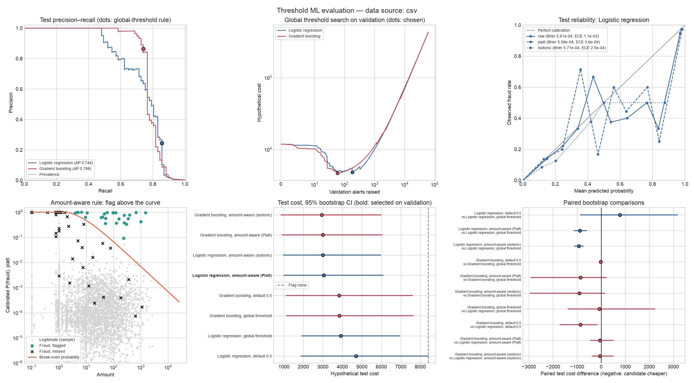

# Threshold ML

**Cost-sensitive credit card fraud detection, evaluated the way a deployment would actually face it.**
Models train on the past. Decision policies are fitted and compared on a later period using an explicit cost model, then frozen. Only then is the most recent period scored. The headline policy uses calibrated probabilities to weigh each payment's own amount at risk, which is the Bayes-optimal rule under the cost model, and it beats the standard tuned threshold by about 23%.



## Results on 284,807 real transactions

Chronological test set: the final 60,140 transactions, containing 77 frauds. Every model, calibrator and policy was frozen before any test data was scored. 95% stratified bootstrap intervals are shown in brackets.

| Model | Decision policy | Test alerts | Frauds caught | False alarms | Hypothetical cost |
|---|---|---:|---:|---:|---:|
| Logistic regression | default 0.5 threshold | 65 | 48 | 17 | 4,696 [1,874, 8,407] |
| Logistic regression | tuned global threshold | 270 | 66 | 204 | 3,922 [1,913, 6,948] |
| Gradient boosting | tuned global threshold | 66 | 57 | 9 | 3,851 [1,145, 7,621] |
| Gradient boosting | amount-aware (Platt) | 67 | 28 | 39 | 2,991 [913, 6,038] |
| **Logistic regression** | **amount-aware (Platt)**, selected on validation | 89 | 26 | 63 | **3,041 [987, 6,081]** |
| — | flag nothing | 0 | 0 | 0 | 8,397 |

**What this shows:**

- **Weighing the amount at risk beats a single threshold.** For logistic regression, the amount-aware rule cuts test cost by 882 [615, 1,122]. It is cheaper in all 1,000 paired resamples, and the interval is nowhere near zero. Gradient boosting gains a similar 860, but with a wider interval [−219, +2,910] because its gain rests on fewer frauds.
- **It catches fewer frauds but saves more money.** For logistic regression the tuned threshold catches 66 frauds and the amount-aware rule 26, yet they're worth almost the same: 6,035 vs 5,849 units. The amount-aware rule also raises 141 fewer false alarms. 42 of the 77 test frauds are under 7 units, less than a false alarm costs, so the rule deliberately lets them through. That's correct under this cost model, but it's a real business risk: small "card-testing" charges often come right before large frauds, and a per-transaction cost model can't see that.
- **Fitting a policy and scoring it on the same data flatters it, and by different amounts.** The tuned threshold looks 623 units better on validation in-sample than cross-fitted. The Platt rule's two parameters overfit by only 7. Comparing in-sample validation costs would have understated the amount-aware rule's advantage, so selection uses cross-fitted costs.
- **Model choice matters less than decision policy.** Under the same policy, the two models' costs differ by under 100, with intervals that span zero. Changing the policy moves cost by about 900.

Full numbers are in [`examples/public/REPORT.md`](examples/public/REPORT.md) and [`results.json`](examples/public/results.json). The dataset hash is recorded in [`ACQUISITION.md`](examples/public/ACQUISITION.md).

## Quick start

```sh
make install         # venv + locked dependencies + editable package
make test            # 47 tests, a few seconds
make demo            # offline synthetic run → results/synthetic/
make reproduce       # download + hash-check the public data, regenerate examples/
```

Or directly:

```sh
pip install -e ".[dev]"
threshold-ml run --source csv --csv data/creditcard.csv --output results/public
threshold-ml run --review-cost 3 --false-positive-cost 10 --loss-rate 0.7   # alternative cost assumptions
threshold-ml score --model results/public/gradient_boosting.joblib --input new.csv --output scored.csv
```

`--source` accepts `synthetic` (the offline default), `csv`, `download` (fails loudly) or `auto`. `auto` falls back to synthetic data and records the fallback reason in the provenance block.

## Method

| Stage | Choice | Why |
|---|---|---|
| Split | 60/20/20 over **unique timestamps**, in time order | No future rows in training; tied timestamps never straddle a boundary |
| Features | V1–V28, `log1p(Amount)`, sin/cos of daily phase, latent-vector norm | Strictly row-local, so no label or cross-row leakage is possible |
| Models | Standardised logistic regression; histogram gradient boosting (120 trees, 15 leaves, lr 0.08, L2 5) | Fixed in advance, with no hyperparameter search to overfit validation |
| Imbalance | No resampling or class weights | The cost-optimal threshold absorbs the imbalance directly |
| Global threshold | Exact O(n log n) sweep over every distinct validation score, including flag-none; ties favour fewer alerts | Gives the true cost minimum, not a grid approximation ([`costs.py`](src/threshold_ml/costs.py)) |
| Calibration | Platt scaling on log-odds, and isotonic regression, both fitted on validation | The amount-aware rule multiplies a probability by money, so the scores must be real probabilities ([`calibration.py`](src/threshold_ml/calibration.py)) |
| Amount-aware rule | Flag when expected loss exceeds expected review cost (see below) | Bayes-optimal under the cost model; no threshold to tune ([`policies.py`](src/threshold_ml/policies.py)) |
| Selection | Lowest **cross-fitted** validation cost over every (model, policy) pair, using 5 contiguous time blocks | Every policy family is fitted and scored identically, so remaining optimism is shared rather than favouring one family |
| Uncertainty | 1,000 stratified bootstrap resamples of test, with every rule evaluated on the same resamples | Paired comparisons cancel shared noise; stratifying keeps the count of 77 frauds fixed |

### Cost model

All costs are hypothetical, in one currency unit:

```
cost = review_cost × alerts + false_positive_cost × FP + loss_rate × Σ amount(missed frauds)
```

The defaults are 2, 5 and 1.0. A flagged fraud is assumed fully prevented.

### The amount-aware decision rule

For a payment of amount *a* with calibrated fraud probability *p*:

```
expected cost of letting it through = p × loss_rate × a
expected cost of flagging it        = review_cost + (1 − p) × false_positive_cost
```

Flagging is optimal exactly when *p* exceeds the break-even probability `(review_cost + false_positive_cost) / (loss_rate × a + false_positive_cost)`, the orange curve in the bottom-left panel. A 10-unit payment needs *p* > 0.47 to be worth flagging; a 1,000-unit payment needs only *p* > 0.007. A global threshold demands the same evidence for both. That is why it overspends review effort on small payments and under-protects large ones.

## Verification

The test suite in [`tests/`](tests) checks:

- the threshold optimiser against brute force over random tie-heavy inputs and random cost parameters
- strict temporal boundaries, with ties forced together
- that features are invariant to labels and to other rows
- schema validation for every failure mode
- that the amount-aware rule picks the cheaper action for every row against brute force, and that its break-even probability is exactly the decision boundary
- that both calibrators recover known probabilities from distorted scores without changing the ranking
- that cross-fitting never sees held-out labels: flipping one block's labels leaves that block's decisions unchanged
- that stratified resampling preserves class counts, and that identical rules give zero paired difference
- that a near-perfectly calibrated simulation yields ECE ≈ 0
- end to end: every policy's metrics recomputed independently from the published prediction CSVs, amount-aware decisions re-derived from the published probabilities, and saved bundles that re-score unlabelled rows to identical outputs

CI runs lint, format checks, the tests and a smoke run on Python 3.11–3.13.

## Limitations

- **One short, anonymised dataset.** It covers two days, and V1–V28 are upstream PCA outputs whose fitting we can't audit for leakage.
- **No customer identifiers.** Per-card behavioural features, usually the strongest fraud signal, aren't possible.
- **The intervals cover test sampling noise only.** They do not cover training or threshold-selection variability; a rolling-origin backtest would be the next step.
- **The cost model is deliberately simple.** It prices each transaction independently, so it can't value catching a small card-testing charge that would have prevented a larger fraud. It also ignores partial recoveries, review capacity limits, label delay and customer lifetime effects.
- **Calibration rests on 59 validation frauds.** The high-probability end of the reliability curve is noisy, which is why both Platt and isotonic are compared rather than assumed.
- **Synthetic runs exercise the software, not the science.**

## Layout

```
src/threshold_ml/
  data.py         schema validation, synthetic generator, provenance-tracked loading
  splits.py       chronological partitioning
  features.py     row-local feature engineering
  costs.py        CostModel, expected-cost decisions, exact threshold optimiser
  calibration.py  Platt (log-odds) and isotonic calibrators
  policies.py     decision policies and time-blocked cross-fitting
  models.py       fixed candidate estimators
  evaluation.py   decision metrics, calibration diagnostics, paired stratified bootstrap
  pipeline.py     two-phase experiment (fit, cross-fit and select → freeze → evaluate)
  scoring.py      ModelBundle carrying every frozen policy for inference
  plots.py, report.py, cli.py
examples/public/     real-data run: report, metrics, figure, predictions, threshold curves
examples/synthetic/  offline demo run
```

Model bundles (`*.joblib`) are regenerated by `make reproduce` and are not committed. Only load joblib files you trust.
