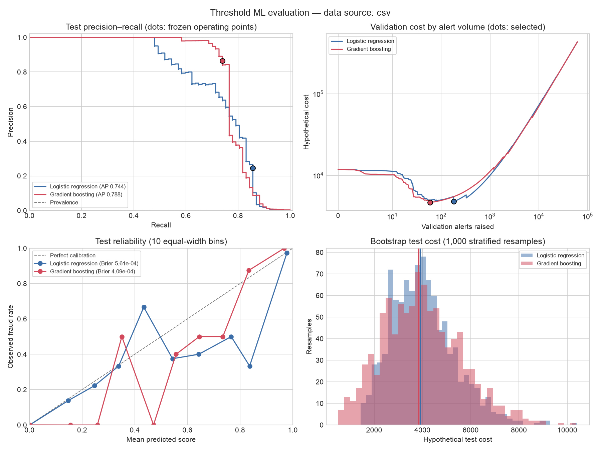

# Threshold ML run — `csv` data

284,807 transactions; chronological split train/validation/test = 162,992 (356 frauds) / 61,675 (59 frauds) / 60,140 (77 frauds).
Selected on validation cost: **gradient_boosting**.

## Test metrics at frozen validation thresholds (95% bootstrap intervals)

| Model | Threshold | Average precision | Precision | Recall | Hypothetical cost |
|---|---:|---:|---:|---:|---:|
| logistic_regression | 0.02574 | 0.744 [0.647, 0.827] | 0.244 [0.215, 0.277] | 0.857 [0.766, 0.922] | 3,922 [1,913, 6,948] |
| gradient_boosting | 0.3892 | 0.788 [0.698, 0.869] | 0.864 [0.783, 0.938] | 0.740 [0.636, 0.831] | 3,851 [1,145, 7,621] |

## Decision outcomes on test

| Model | Rule | Alerts | TP | FP | FN | Cost |
|---|---|---:|---:|---:|---:|---:|
| logistic_regression | validation threshold | 270 | 66 | 204 | 11 | 3,922.20 |
| logistic_regression | default 0.5 | 65 | 48 | 17 | 29 | 4,695.75 |
| gradient_boosting | validation threshold | 66 | 57 | 9 | 20 | 3,851.44 |
| gradient_boosting | default 0.5 | 64 | 57 | 7 | 20 | 3,837.44 |
| — | flag none | 0 | 0 | 0 | — | 8,396.81 |
| — | flag all | all | — | — | 0 | 420,595.00 |

## Model comparison

- `gradient_boosting_minus_logistic_regression` test cost: -71 [-1,376, 2,224]. gradient_boosting is cheaper in 59% of paired resamples.

## Calibration (test)

| Model | Brier score | Expected calibration error |
|---|---:|---:|
| logistic_regression | 5.61e-04 | 1.14e-03 |
| gradient_boosting | 4.09e-04 | 1.70e-04 |

A single chronological holdout; intervals capture test sampling noise, not training variability.
Costs are hypothetical, not realised savings.

