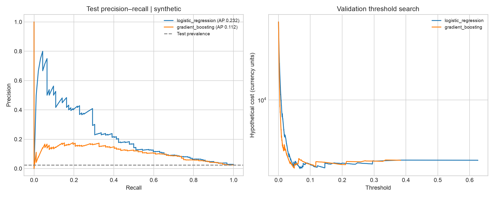

# Measured run: synthetic

Rows: 20,000. Selected using validation cost: **logistic_regression**.

| Model | Test AP | Precision | Recall | Hypothetical test cost |
|---|---:|---:|---:|---:|
| logistic_regression | 0.2323 | 0.1780 | 0.4565 | 4495.78 |
| gradient_boosting | 0.1115 | 0.1446 | 0.3804 | 4882.02 |

Synthetic results demonstrate software behavior only.
Costs are hypothetical, not realized savings.

